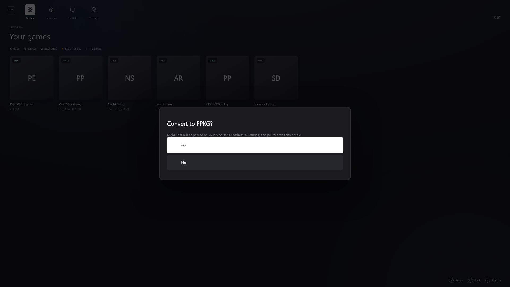
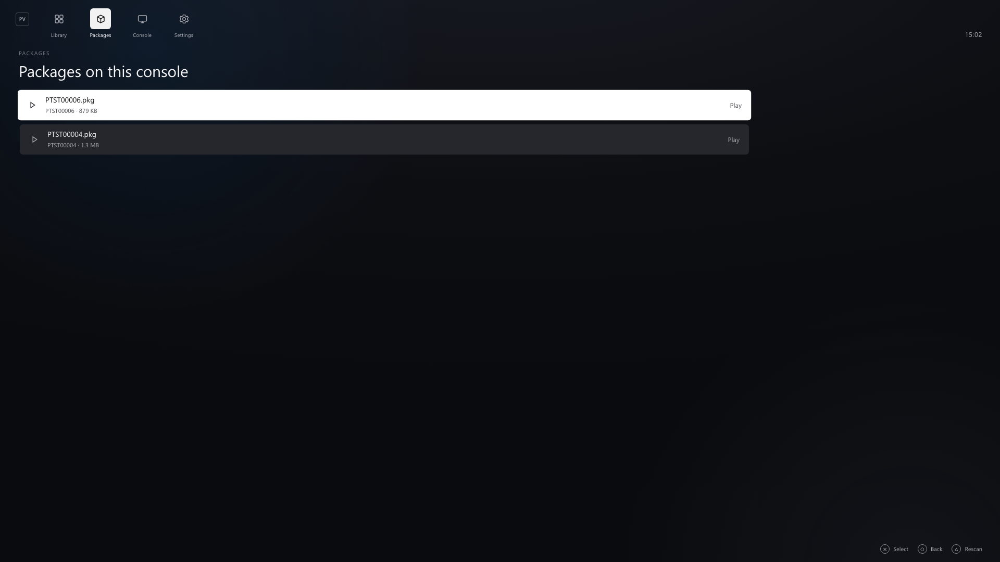
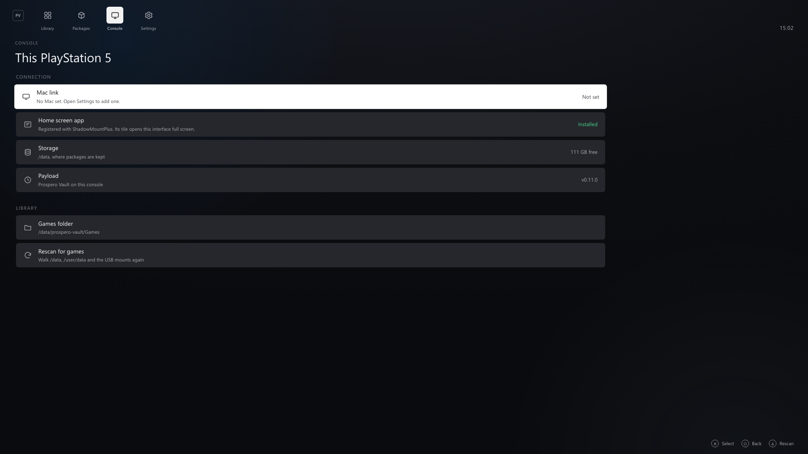
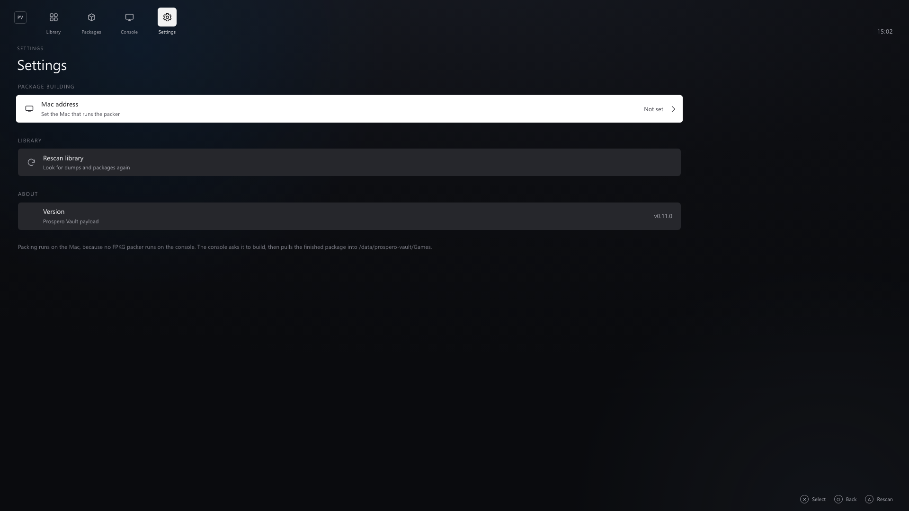
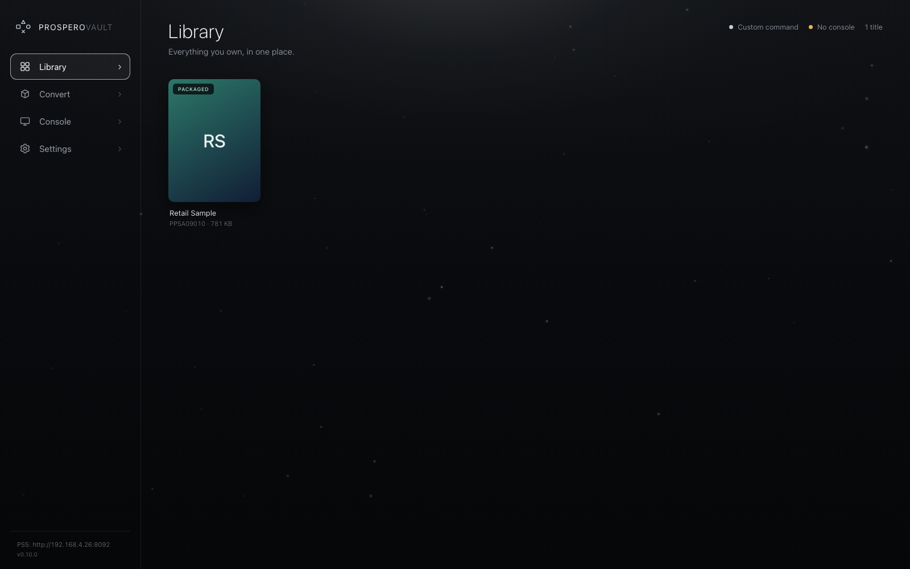
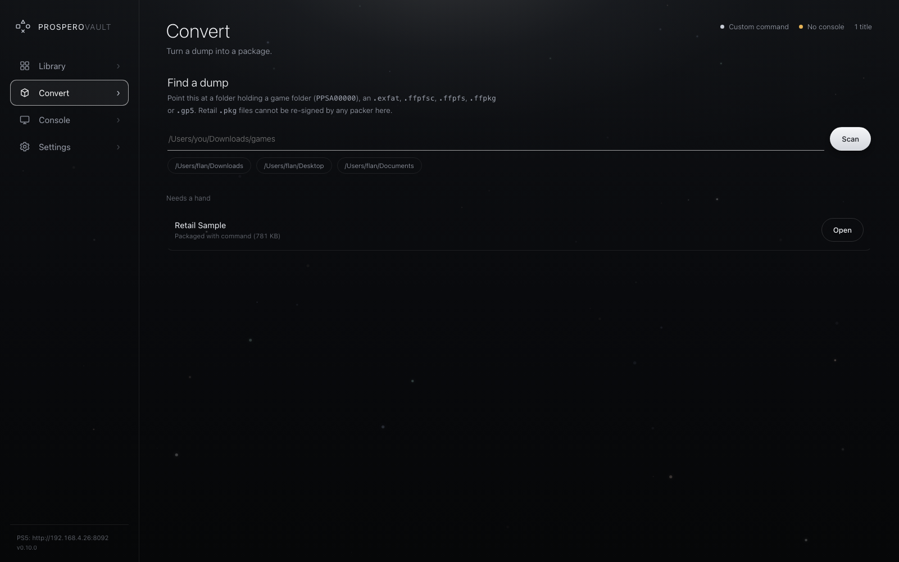
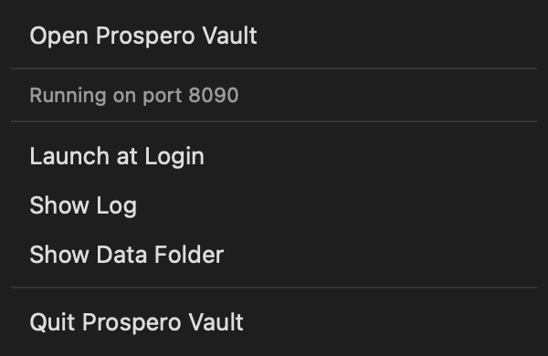

# Prospero Vault

Prospero Vault is a native PS5 title. It launches from the home row, draws its
interface into VideoOut's tiled framebuffer, and reads the DualSense directly. A
payload loaded with `elfldr` is the title's backend: it scans the library, hands
installs to the console, converts through the Mac, and starts titles. The Mac
app still builds the packages; packing on the console itself needs a native
package engine and is not in this build. The exact blocker is recorded under
"Limits" rather than hidden.

The native title lives in `console-native/`. The payload and the browser page it
serves remain as the backend API and as the fallback interface. This README
covers all three: the title, the Mac app, and the tests that show what works.

**Tested on:** PS5 firmware **13.20**, **ShadowMount+ 1.7beta12**, `elfldr` on
port 9021. **Firmware 14.xx cannot run this or any other payload**: there is no
public exploit above 13.60 as of November 2026.

**FPKG install is a second, separate ceiling.** Public kstuff builds install and
launch debug FPKGs only through **11.60**. On 13.20 the installer accepts the
request and then rejects the package with `0x80BD0005`; this is a kernel-patch
limit, not a Vault bug. Mount a dump or image with ShadowMount+ on 13.20, or use
a console on 11.60 or older for install-and-launch.

## The console title

`console-native/` builds `PVLT00001` as a development FSELF: a native PS5 ELF
(`e_type=0xFE10`) with process parameters, the generated clean-room
`sce_module/libc.prx`, and a controller-first interface drawn on VideoOut.
ShadowMount+ registers the folder, so the tile is a normal home-row app, not a
page in the browser and not a renamed payload.

```bash
./console-native/build.sh
nc -w 30 192.168.4.100 9021 < console-native/dist/install.elf
```

The installer stops a running Vault, writes the whole folder with the `0777`
modes ShadowMount+ needs, and leaves the tile ready to launch. It is one ELF
over `elfldr`; there is no FTP step. The title needs the backend payload on
`127.0.0.1:8097` (it falls back to `8098`), and reports its own state on 8096:

```bash
curl http://192.168.4.100:8096/
# {"ok":true,"app":"prospero-vault","native":true,"frames":470,"games":21,...}
```

The native title was launched on the tested **13.20** console. Its frame counter
advanced while it read 21 titles from the backend. The screen itself and the
controller buttons were not captured or visually checked in that run; treat the
look and the button mapping as needing your eyes on the console.

## The screens (browser fallback)

These images show the browser interface served by the payload. It is the
fallback and the backend's own page, not the native title. They are Mac
previews, not console screenshots. The native title draws a controller-first
list on VideoOut and is not pictured here because no console capture was taken.


**Library.** One tile per title. Each tile shows its format, name, size and title
id. The bar at the top shows how many titles, dumps and packages were found, the
Mac connection and free space.



**Convert.** Press a dump and confirm. The Mac builds the package and the console
downloads it. A finished package plays with one press; a new one installs first.



**Packages.** Every package on the console, installed or waiting for install.



**Console.** Mac address, storage, payload version, games folder and rescan. The
Web tile fallback row writes the shell icon only when the native title is absent.



**Settings.** Set the Mac address here once. The console uses it for every build.



**The Mac app.** The same library in a browser: Convert for new builds, Console
for the connection, Settings for the packer and the LAN address.



**Convert on the Mac.** Point the app at a dump folder, scan, then build. The
list shows what each build used and whether it produced a package.

## What you need

- A PS5 that can load homebrew payloads, with `elfldr` on port 9021 and a file
  manager on port 8888. This guide uses `192.168.4.100` as the console address.
  The tested machine is firmware **13.20** with **ShadowMount+ 1.7beta12** and
  `elfldr` on 9021. Firmware 14.xx has no public exploit, so no payload can run
  there at all.
- A Mac on the same network. The app carries its own Bun runtime and `acpack`,
  so you do not install Bun or .NET.
- A decrypted game dump: a folder with `eboot.bin` and `sce_sys/param.json`.
  PS4 dumps with `param.sfo` work too.

## Install the Mac app

```bash
./tools/build-app.sh
open "build/Prospero Vault.app"
```

`bun run build:app` does the same. The Mac that builds it needs the Xcode
command line tools and Bun. The result is `build/Prospero Vault.app` (about
140 MB). Drag it to `/Applications` when it works.

The first build may take a minute. The script publishes `acpack` for this Mac,
copies the Bun runtime, compiles the menu bar shell, and signs the bundle. With
no signing identity it uses an ad-hoc signature, which runs on the Mac that built
it.

To sign and notarize for other Macs, set these before building:

```bash
DEVELOPER_ID_APPLICATION="Developer ID Application: Name (TEAMID)" \
NOTARY_PROFILE="notary-profile" \
./tools/build-app.sh
```

You can use `APPLE_ID`, `APPLE_TEAM_ID` and `APPLE_APP_PASSWORD` instead of
`NOTARY_PROFILE`. The script skips signing and notarization when the variables
are absent.

### First run

1. Double-click the app. A **PV** item appears in the menu bar. There is no Dock
   icon.
2. The app starts the server on port 8090. Data lives in
   `~/Library/Application Support/Prospero Vault/data`; the log is
   `~/Library/Logs/Prospero Vault.log`.
3. Open the **PV** menu for the controls. They are listed below the first-run
   steps.
4. Find this Mac's address:

   ```bash
   ipconfig getifaddr en0
   ```

   Type `<that-address>:8090` into the console's Settings. You can also let the
   first package send teach the console the address.

5. Allow incoming connections if macOS asks. Without that, the console cannot
   reach the Mac.

If you never use the console, set `"bind": "loopback"` in
`~/Library/Application Support/Prospero Vault/data/config.json`. The app then
serves the browser UI on this Mac only.

### Menu bar controls



**The PV menu.** It shows whether the server is running, then the actions.

| Item | What it does |
| --- | --- |
| **Open Prospero Vault** | Starts the server if needed and opens `http://127.0.0.1:8090/`. |
| **Launch at Login** | Adds or removes the login item. The tick shows the current state. |
| **Show Log** | Shows `~/Library/Logs/Prospero Vault.log` in Finder. |
| **Show Data Folder** | Opens `~/Library/Application Support/Prospero Vault`. |
| **Quit Prospero Vault** | Stops the server it started and exits. |

The menu is a SwiftUI view shared by the status item and the screenshot tool.
Regenerate the image with `bun run capture:menu`.

## Put the backend payload on the console

```bash
make -C console
```

The build writes `console/build/prospero-vault.elf`. To load it:

1. Open `http://192.168.4.100:8888/` and go to `data/`.
2. Enter `prospero-vault/` (create it if needed).
3. Upload `console/build/prospero-vault.elf`.
4. Load `/data/prospero-vault/prospero-vault.elf` with `elfldr` on port 9021.

Copying the file alone does not start it. The payload is the backend; the native
title is installed separately with the one-shot `install.elf` above. If you
cannot use the native title, the payload still serves the browser interface at
`http://127.0.0.1:8097`, or at `http://192.168.4.100:8097` from another device.

## Convert a dump

1. Put the dump on the Mac or in `/data/prospero-vault/Games/` on the console.
2. Set the Mac address on the console, or start a build from the Mac app.
3. Press the dump's tile and choose **Yes**.
4. The console asks the Mac to build. The Mac pulls the dump if it only exists
   on the console, builds the package, and the console downloads it.
5. Press the finished package to install and play it.

A dump is a folder shaped like this:

```
PPSA01234/
  sce_sys/
    param.json      titleId, titleName, contentId, version, category
    icon0.png       optional
  eboot.bin         the game executable
```

Folder names do not matter. Upper-case names and extra files are fine. DLC is a
dump whose `param.json` has `applicationCategoryType: "ac"`. A dump with more
than 200,000 files is refused instead of walked for hours.

## Test with a real dump and a real console

Run the gate before you convert anything:

```bash
bun run dev
bun run preflight --dump "/path/to/PPSA01234-app" --console 192.168.4.100:8097
```

It checks all 14 preconditions for both delivery paths, including a decrypted
`eboot.bin`, valid dump metadata, both directions of the network path, and
writable console storage. It prints a PASS or FAIL line with a fix for each
failure, then writes `data/last-gate.json`. Nothing is built while a check
fails.

When every line passes, add `--run` to build and deliver:

```bash
# dump is on the Mac
bun run preflight --dump "/path/to/PPSA01234-app" \
  --console 192.168.4.100:8097 --path mac --run

# dump is on the console in /data/prospero-vault/Games
bun run preflight --dump "/path/to/PPSA01234-app" \
  --console 192.168.4.100:8097 --path console --run
```

The Mac path builds here and asks the console to pull the package. The console
path starts the console's own Convert job, pulls the dump to the Mac, builds it,
and sends the package back. Both end with the package in
`/data/prospero-vault/Games/PPSA01234.pkg`.

Without `--run`, press Convert on the console after the gate passes. It runs the
same steps.

## Supported sources

| Source | Shown as | What happens |
| --- | --- | --- |
| PS5 dump folder (`sce_sys/param.json`) | PS5 | builds a package |
| PS4 dump folder (`sce_sys/param.sfo`) | PS4 | builds a package if the packer supports it |
| DLC (`applicationCategoryType: "ac"`) | PS5 | builds an AC package |
| `.pkg` | FPKG | installs and plays |
| `.exfat`, `.ffpkg`, `.ffpfs`, `.ffpfsc` | IMG | mounts with ShadowMountPlus, then plays |
| Retail `.pkg` | FPKG | refused: encrypted to the buying console |
| Update content (`gp`) | not listed | refused: patches are not supported |

## What is verified

Run everything with:

```bash
bun run test
```

| Command | Checks | What it covers |
| --- | --- | --- |
| `bun run test` | 324 | the self-check, gate and app suites |
| `tools/selftest.ts` | 247 | discovery, `param.sfo` parsing, builds, serving, resume, deploy, soak tests, CSRF, loopback |
| `bun run check:gate` | 43 | the real payload on the LAN, both build paths, broken preconditions, restart |
| `bun run check:app` | 34 | the packaged app with no Bun or .NET, menu handlers, login launch, quit |
| `bun run check:dumps` | 52 | synthetic dump shapes from scan to package |
| `bun run check:pipeline` | 42 | background pulls, packer exit codes, failed builds, cleanup |
| `bun run check:payload` | 68 | the payload's HTTP contract, built for this Mac |
| `bun run check:ui` | 77 | the console interface in a browser |

The payload compiles for the PS5 with no warnings. The console build loads on a
**13.20** console with `elfldr` and serves the library on 8097; that hardware run
has been done. The native title was staged with `dist/install.elf`, launched by
LNC as `PVLT00001`, and answered on 8096 with an increasing frame count and 21
titles. These paths are still unproven on hardware:

- install a package built here;
- start it from this app and from the home screen;
- open a DLC package;
- mount an `.exfat` dump;
- the native title's on-screen layout and controller mapping (not visually
  checked; the frame loop and backend feed were checked).

Until those pass on a console, treat them as unproven. The build and transfer
paths are tested against the real payload compiled for this Mac, not emulated.

Two build details are load-bearing on 13.20:

- the payload is PIE (`ET_DYN`); `elfldr` does not spawn the non-PIE `ET_EXEC`
  the old Makefile produced;
- `libSceAppInstUtil` is not linked. Mapping it into a payload process crashes
  on 13.20, so installs are handed to the console's local installer service
  over loopback HTTP.

## Troubleshooting

**The console cannot reach the Mac.** Allow incoming connections for the app in
macOS Settings, then run the preflight again. The gate names the direction that
failed.

**The Mac cannot reach the console.** Check that the payload is loaded and
listening on 8097. The console may have picked 8098 if 8097 was busy; the payload
log says which port it took.

**Port 8090 is already in use.** Quit the other copy:

```bash
lsof -nP -iTCP:8090 -sTCP:LISTEN
```

**The menu says "Not running".** Open **Show Log**. A port conflict or a missing
bundle file is the usual cause.

**A dump is rejected.** The message names the missing or bad file. Common cases:

| Message | Fix |
| --- | --- |
| `has eboot.bin but no sce_sys/param.json` | recopy the dump with `sce_sys/` |
| `has sce_sys metadata but no eboot.bin` | recopy the executable |
| `missing contentId` | export the dump again with its metadata |
| `has no \x7fELF header` | decrypt the dump first |
| `this is a retail package` | retail packages cannot be re-signed |
| `update content (gp) is not supported` | package the base game, not the patch |

**A build fails.** The job card shows the packer's message. The log has the full
command output.

**Ask for help.** Send the log, `data/last-gate.json`, the preflight output, and
`/data/prospero-vault/payload.log` from the console.

## Security

Both servers use plain HTTP and have no password. The Mac app rejects changes
sent from another website, but anyone on your network can read the library and
ask the Mac to build. Keep ports 8090 and 8097 on your home network. Do not
forward them from your router. Use `"bind": "loopback"` when the console is not
involved.

There is no shared secret between the Mac and the console. The payload's API has
no field for one, and adding one would break the path already tested on this
network.

## Develop

```bash
bun run dev        # Mac app on http://localhost:8090
bun run preview    # browser fallback UI on http://localhost:8094
make -C console    # PS5 backend payload
./console-native/build.sh  # native title + installer
bun run capture:menu  # refresh docs/screens/status-menu.png
```

`bun run preview` serves the exact page embedded in the payload and proxies
conversions to the Mac app. It uses generated demo titles, so you can test the
interface without a console.

The main folders:

```
console/main.cpp        payload: scan, HTTP, convert, install, play
console/ui/index.html   the browser fallback interface
console-native/         native VideoOut title, installer, build pipeline
app/                    the Mac app and packers
public/                 the Mac app's page
tools/                  checks and the app builder
docs/screens/           screenshots used here
```

## Limits

- **On-console packing is not implemented.** The packer is `LibProsperoPkg`
  (C#/.NET, about 31,000 lines). The payload is a FreeBSD ELF with no .NET
  runtime, so a native C++/C port of the PKG/PFS writer is required before a
  dump can be packed without a Mac. Until that port exists, Convert runs on the
  Mac. This is the single biggest missing feature, not a flag.
- **Firmware 14.xx cannot run this, or any other payload.** Public exploit
  chains stop at 13.60; 14.00/14.10 are private and 14.20+ has no public
  jailbreak as of November 2026. No Vault change can create kernel access.
- Install now depends on the console's local installer service on port 8888,
  and on kstuff actually supporting FPKG installs. On 13.20 it does not: the
  service returns `0x80BD0005` after accepting the request. If the service is
  missing, Vault says so instead of pretending the package was handed over.
- An on-console packer would not make this console play the result: FPKG install
  itself is the ceiling on 13.20. Mounting is the supported path there.
- **The native title is a development FSELF, not a retail PKG.** It is built
  with the public native-app toolchain (`tooling/native`, `ps5-pie.ld`, an
  FSELF writer) and the generated clean-room `libc.prx`. It was verified on
  **13.20** only; other firmware and loader combinations are unverified, and the
  toolchain upstream targets Linux/WSL even though this Mac builds it.
- **The title needs the payload for everything except drawing and input.** If
  8097/8098 is silent it shows `BACKEND OFFLINE` instead of an empty library.
- The shell web tile remains as a fallback, but the payload now refuses to
  overwrite a native eboot or delete the native folder. `POST /api/home-app` on
  a native install returns the "left alone" message; `remove` refuses too.
- The payload cannot change a game's frame rate or resolution.
- Patches (`gp`), firmware images and retail packages are not supported.
- Signing and notarization need your Developer ID. The app check covers the
  ad-hoc build on this Mac.
