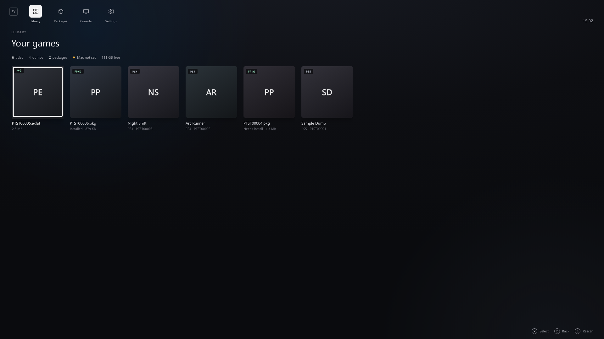

# Prospero Vault

A package library that runs **on the console** and behaves like a system app:
an icon row across the top, a grid of what you own, one-tap conversion of a
dump into an FPKG, and the finished package pulled onto the PS5.



## How it compares

Kraken Mount (v0.3.0) mounts a game from the drive it already sits on; Prospero
Vault builds a real debug FPKG and installs it through the console's own
installer. Mounting costs no disk and no wait; installing gives you a title that
behaves like any other, with a package on disk you can copy anywhere and a
library that knows what state every game is in.

| | Prospero Vault | Kraken Mount v0.3.0 |
| --- | --- | --- |
| Builds a package from a dump | Yes — fpkg-cli, orbis-pub-cmd, LibProsperoPkg, or a command you set | No — mounts an existing debug FPKG or folder |
| Runs from | The console's own storage, via Sony's installer | Its source (internal, M.2, USB) |
| Disk cost | One copy | Cache only |
| Formats | Folders, `.exfat`, `.ffpfsc`, `.ffpfs`, `.ffpkg`, `.gp5`, debug `.pkg` | Debug FPKG, plain / zstd / LZ4 folder |
| Resumable, verified transfer | Yes | Not needed — nothing is copied |
| DLC / PlayGo | Packed on the Mac | Bundled emulators |
| Failure reporting | A named reason on every path; a simulated build is labelled and refused by the console | Log lines |

Full comparison, including where Kraken Mount is ahead and what we are closing
next: [docs/COMPARISON.md](docs/COMPARISON.md).

## Name and artwork

**Prospero** is the PS5's codename; a *vault* is where the packages live.

| File | Use |
| --- | --- |
| `public/icon.svg` | app icon (1024 grid, rounded-square, vault wheel) |
| `public/hero.svg` | 16:9 home banner with wordmark |
| `console/ui/index.html` | the same mark inline, so the payload needs no extra files |
| `docs/screens/*.png` | the screens as rendered in the preview |

The console UI cannot fetch images from the payload — the ELF serves the page and
the API only — so the icon is inline SVG and the browser never asks for a file.

## How it fits together

```
        the console                                    your Mac
┌─────────────────────────────────┐          ┌──────────────────────────┐
│  prospero-vault.elf  :8097      │          │  Prospero Vault  :8090   │
│                                 │          │                          │
│  scans /data, /user/data, USB   │  build   │  your packer:            │
│  serves the UI (embedded)       │─────────▶│   fpkg-cli / orbis-pub   │
│  thumbnail grid, icons          │◀─────────│   / a command you set    │
│  pulls the finished .pkg        │  .pkg    │                          │
└─────────────────────────────────┘          └──────────────────────────┘
```

One file goes to the console. Its interface is compiled into the ELF, so there
is nothing else to copy and nothing to keep in sync.

## The screen

- **Rail** — Library, Packages, Console, Settings. The active category is a
  white tile; focus is a white ring, exactly like Settings on the console.
- **Library** — hero banner with counts, Mac link and free space, then one square
  tile per title using `icon0.png` when the dump has one.
- **Packages** — rows for what is already packaged, with Play.
- **Console** — Mac link, storage, payload version, games folder, rescan.
- **Settings** — the Mac address (`host:port`), rescan, version.
- **Detail** — large art, type/size/status, Convert, Play, Back.
- **Converting** — a dimmed screen with one thin bar, the current step, the
  percentage and Cancel.
- **Controller** — D-pad/left stick move, ✕ selects, ○ goes back, △ rescans.
  Arrow keys and Enter do the same from a keyboard.

## Why the Mac is still involved

Packing an FPKG needs a desktop packer. Sony's Publishing Tools and
`LibProsperoPkg` are desktop binaries; there is no way to run them on the
console. So **Convert** asks the Mac to build and then pulls the result down:

0. console asks `GET /api/ready/<TITLE_ID>` first — if the Mac already holds the
   package, the pack is skipped and it goes straight to the transfer
1. console: `POST http://<mac>:8090/api/build`
2. console polls `GET /api/progress/<TITLE_ID>` for the percentage and step until
   the package exists
3. console downloads `/api/pkg/<TITLE_ID>` into `/data/prospero-vault/Games/`,
   resuming from the `.part` with a `Range` request if an earlier try was cut off
4. console rescans, so the new package appears as a tile

Send to PS5 in the Mac app uses the same path in reverse: it asks the console to
fetch (`POST /api/convert`), the console pulls on its own worker thread, and the
Mac follows `/api/convert/status` so the library says what actually happened.
The Mac sends its own `host:port` with that request, so the console learns where
to pull from without anyone typing the address into Settings first.

Both halves tidy up after themselves, so what is left at the end is the package
and nothing else:

- the Mac assembles each build in `data/tmp/<TITLE_ID>-<stamp>/`, moves the one
  finished file to `data/pkg/<TITLE_ID>.pkg`, and deletes the scratch folder.
- stale `*.part`, `*.tmp` and scratch folders are swept at startup.
- the console writes the download to `<TITLE_ID>.pkg.part` and renames it only
  after the full byte count has arrived. A failed transfer leaves nothing that
  looks playable, and leftovers are cleared on the next start.

## What the audit changed

Everything below was a real defect found by reading the payload for a first
hardware run, not polish:

| Problem | Fix |
| --- | --- |
| A dropped connection mid-download was silently accepted, so half a package was renamed into place and looked playable | `Content-Length` is read from the response and the transfer must match it exactly, or the `.part` is deleted |
| One stalled client froze the whole payload (single-threaded accept, blocking `recv`) | socket send/receive timeouts on every connection, outbound calls included |
| `accept()` returning `EMFILE`/`EAGAIN` ended the payload | transient errors are retried with a short sleep |
| A large `icon0.png` was cut at a fixed 512 KB buffer, producing broken tiles | icons stream in 16 KB chunks with the real `Content-Length` |
| The games JSON had a 32 KB cap, so a full 200-title library produced truncated (unparseable) JSON | 96 KB buffer, larger name cap, UTF-8-safe truncation |
| Scanning `/user/data` and eight USB mounts held the title lock for the whole walk, freezing the UI | the scan fills a scratch array and swaps it in under the lock |
| Multi-gigabyte transfers sat at a flat 96% | the bar moves during the pull and shows `received / total` |
| If the packer failed on the Mac the console polled for a full hour before giving up | progress now carries `state`/`message`; the console fails immediately and shows the reason |
| No way to stop a long conversion | `POST /api/convert/cancel`, wired to the Cancel button |
| Double-tapping Convert could queue the same title twice | the Mac tracks queued titles, and the console refuses to convert a title that is already a package |
| `payload.log` grew forever | rotated to `payload.log.1` at 1 MB on startup |
| `which` ran three subprocesses per UI poll | engine probe cached for 5 s |
| A build whose source folder had been moved failed late, after the queue | the source path is checked before queueing |

A second pass, for the hardware test:

| Problem | Fix |
| --- | --- |
| Every request was served on the accept loop, so one slow icon or a rescan froze the whole interface, and the parse buffer was `static` | one detached worker thread per connection (24 at once, 512 KB stacks), per-connection buffers, and a refusal instead of `EMFILE` when saturated |
| `POST /api/scan` walked every mount on the serving thread | it claims the scan, starts a worker and answers `202` at once; the grid fills in from the poll |
| `/api/games` re-serialised the whole library and wrote into a shared `static` buffer on every poll | serialised once per scan into a cache and copied out under the lock |
| Every redraw re-read each `icon0.png` from flash | 32-entry / 12 MB LRU icon cache, cleared on each scan |
| A full disk looked like a successful transfer, because write errors were ignored, and the rename could publish unwritten bytes | writes are checked, the file is `fsync`ed, and the rename only happens after that |
| A dropped Wi-Fi link restarted a multi-gigabyte pull from zero | the console keeps the `.part` and continues with `Range: bytes=N-`; the Mac answers `206` and a stale partial is detected by size |
| Convert always asked the Mac to pack, even when the package was already there | `/api/ready` is checked first, so a second convert is just a transfer |
| An unreachable Mac could block `connect()` for about 75 seconds | non-blocking connect with a 6-second limit, plus socket timeouts on outbound calls |
| Send to PS5 posted to `/api/install`, which the payload never had | it now asks the console to fetch, and the Mac follows the console's own progress |
| The Mac address went into a request line unchecked | `host` / `host:port` is validated before it is stored |
| Send to PS5 only worked if the console had already been told the Mac's address | the Mac sends its address with the job and the console adopts it |
| A dump and a package with the same title id could leave the tile showing the dump, with no Play | the package wins the scan |
| Log lines from different threads could interleave | a log mutex |

A third pass, for the first hardware run and the one-tap path:

| Problem | Fix |
| --- | --- |
| A converted package could not be started: Play launched a title the console had never installed | the payload installs it here with the console's own installer and starts it — one tap, no PC, no mount payload |
| The interface could not tell an installed title from a downloaded file | every title carries `installed`, read with `sceAppInstUtilAppExists` on each scan |
| `http_call` wrote every response into one `static` buffer while Play and a conversion could both be using it | a per-call buffer |
| If the Mac restarted mid-pack the console polled a dead job for an hour at a frozen percentage | `404` and twenty silent polls both fail immediately with something to do about it |
| Converting while a game ran pulled gigabytes and competed for the game's disk and Wi-Fi | `409` with the reason, instead of quietly degrading play |
| The payload's HTTP contract was only checked by a script in `/tmp` | `tools/payload-check.sh` (`bun run check:payload`) builds a host payload and asserts the whole contract |

## Play

Play starts the title on the console. The payload calls Sony's own launcher —
`sceLncUtilLaunchApp`, then `sceSystemServiceLaunchApp` — after reading the
foreground user, because the launcher rejects a user id of `0`. The symbols come
from the SDK's link stubs (`libSceSystemService`, `libSceUserService`,
`libSceAppInstUtil`), which the console binds when the ELF loads. They ship
without headers, so `main.cpp` declares the prototypes and the Makefile links
the three libraries.

Three details decide whether that feels right:

- `sceSystemServiceLaunchApp` returns the **new app id** on success, so only a
  negative value is a failure. Reading it as "must be zero" fires a second
  launch at a title that is already starting — and the shell responds by pushing
  the game into the background, the "opens then instantly minimises" bug.
- An already-running title gets exactly one request: the payload foregrounds it,
  returns `409`, and never launches again.
- Success is confirmed by polling `sceLncUtilIsAppLaunched` for up to three
  seconds, instead of trusting a return code Sony does not report reliably.

When ShadowMountPlus happens to be running (`POST 127.0.0.1:10101/api/v1/version`
answers), the payload asks it for the two things it cannot do itself — the
fake-library policy a debug FPKG needs, and a mount for a disc image — then
launches. When it is not running, Play still calls Sony's launcher directly.
Nothing is bundled and **no cache is built**, so playing costs no extra disk and
there is no rebuild step before a game starts.

A dump folder is not launchable, and `/api/play` says so with `409` instead of
failing somewhere inside the shell.

## Install, then play

A `.pkg` sitting in the library is not the same as an installed title: the shell
will not start a package it has never installed. That used to be the end of the
road here. It is now the one thing Play handles for you.

- `sceAppInstUtilAppInstallPkg(path, NULL)` hands the local file to the
  **console's own installer** — the same component Debug Settings uses. There is
  no third-party mount payload, no PC in the middle, and no rebuild step.
- The call returns as soon as the console accepts the package; the install then
  runs on Sony's service. So progress is not guessed: the payload polls
  `sceAppInstUtilAppExists(titleId, &exists)` and only says "ready" when the
  console says the title exists. The bar creeps across a four-minute span rather
  than claiming a percentage nobody reported.
- `POST /api/play` on an uninstalled package answers `202 {"installing":true}`
  and starts it the moment the install lands. `POST /api/install` does the same
  without launching, for when you just want it on the console.
- Every tile says `Installed` or `Needs install`, from a single
  `sceAppInstUtilAppExists` per package during the scan. The button reads
  *Install & play* when that is what will happen.
- One background task at a time: a conversion and an install share one slot, so
  two of them can never fight over the same disk and the same Wi-Fi.
- Installing is refused while a game runs (`409`, with the reason). It is also
  refused with `501` on a host build, which has no installer and must not
  pretend otherwise.

The one thing that stays true: this is the console's installer. A package built
for another firmware, or one that is not a debug package, is turned down by the
console, and the payload passes its error code straight through instead of
inventing a friendlier story.

## The app's own tile

Prospero Vault is in the home screen's app row, and pressing its tile opens this
interface full screen — no browser around it, no bookmark to find. It installs
itself: on first run the payload writes a title folder and the home screen picks
it up.

There is no FPKG and no signing in that path, which is what made it look
impossible. Every store in this space — ProsperoStore, Pegasus DL+, Playden,
RecompStore — is a folder registered by the **ShadowMountPlus** payload, and the
console treats a registered folder as a title like any other. What the folder
needs is a native `eboot.bin` and `sce_sys/param.json`:

```
/data/homebrew/PVLT00001/
  eboot.bin              the console's web-app shell
  sce_sys/param.json     title id, name, and deeplinkUri
  sce_sys/icon0.png      512x512, drawn by tools/icon.py
```

`deeplinkUri` is the address the shell opens, so the tile lands on
`http://127.0.0.1:<port>/`. That one field is the whole difference between a
tile that opens this interface and a tile that does nothing: the eboot is the
console's own web-app shell (`/system_ex/app/NPXS40106/eboot.bin`), which is how
the Homebrew Launcher and Sonic Loader tiles work too. The icon is embedded in
the payload, so the tile is drawn by the app itself.

Console → **Home screen app** writes it (or repairs it) and asks
ShadowMountPlus for a scan so the tile appears at once instead of at its next
fifteen-second pass. Details that decide whether it starts at all are in
`docs/home-screen-apps.md` — the title ID must be four letters and five digits,
and every file must be `777`, or the console answers `CE-107750-0`.

A folder on disk is not a tile, so that row does not claim one. It asks
ShadowMountPlus per title (`POST /api/v1/games/info`, not the whole library,
whose answer is larger than one reply here can hold) and reports **Installed**
only when the payload says it holds `PVLT00001`. Until then it says **Pending**,
and the message names why: nothing answering on `127.0.0.1:10101`, or a scan path
that does not include `/data/homebrew`.

Pressing the row when it is installed asks before it removes: the folder is
deleted, the title uninstalled and a scan requested, and a marker file keeps the
next start from putting the tile back. The folder goes first on purpose —
ShadowMountPlus refuses to uninstall the title that is currently running, which
is this one, and a registration whose source is gone is dropped by the scan that
follows.

## The console's own path

A launched package takes exactly the route a game bought from the store takes:

1. `sceAppInstUtilAppInstallPkg` puts it in `/user/app/<titleId>` and registers
   it with the shell — the same component Debug Settings uses.
2. The shell mounts it from there and owns the mount. Nothing emulates a
   filesystem, and no third-party payload sits in the middle.
3. `sceLncUtilLaunchApp` asks the shell to start it, the same call Play uses.

Step 1 is also what gives the **game** its own tile. The shell registers an
installed title in the home screen's games row, so a package installed here
starts from the home screen like any other game: this app does not have to be
open, and nothing is emulated for it to appear. That is why Play installs before
it launches instead of mounting the package itself.

The payload used to ask ShadowMountPlus for a "fake library" before launching a
package. That is gone: once the console has installed a title there is nothing
left to fake, and an extra mount layer would be a *different* path, not the
normal one. ShadowMountPlus is now involved only for disc images — the one
format the shell cannot attach by itself — and if nothing is listening on
`127.0.0.1:10101` the list marks that image `native: false`, Play is disabled,
and the payload explains that converting it to a package installs it natively.

### Processors, memory, and what a payload can actually say about them

A game's CPU and memory budget is assigned by the shell when it starts; a
payload cannot raise it, nor steer a title onto different cores, and this
project does not pretend to. What the payload controls is **its own** footprint
while a title runs, and that is now as close to zero as it can be:

- the 12 MB icon cache is freed the moment a launch succeeds — it is the
  payload's largest allocation, and no icon is read during play;
- no scanning, and a scan request answers `202` and defers;
- one watchdog wakeup every ten seconds, and nothing else;
- the interface stops polling and stops its controller loop while its tab is
  hidden, so the browser is not competing with the game either.

Measured frame-time impact of all that: not measured, and there is no honest way
to claim one from a Mac. The claim here is only that the payload is idle during
play, not that a game runs faster.

## A dump that lives only on the console

The packers run on this Mac, and the console has none. Until now that meant the
dump had to already be on the Mac — which is not how anyone's files are
arranged: the dump is on the PlayStation. The console now serves its own dump
and the Mac pulls it:

1. the console asks the Mac to build with `{"titleId": "…", "pull": true}`;
2. `GET /api/tree/<titleId>` streams the dump's file list as it walks it — the
   console writes the JSON straight to the socket, so a dump with tens of
   thousands of files needs no matching buffer;
3. `GET /api/dump/<titleId>/<path>` streams each file with its real
   `Content-Length`;
4. the Mac pulls four files at a time into `data/pulled/<titleId>`, streams each
   one to disk rather than into memory, reads `param.json` or `param.sfo` for the
   title, registers it in the library, and packs it with whichever engine is
   configured;
5. the finished package comes back to the console and installs natively.

A path coming from the console is treated as untrusted on both sides: the Mac
refuses absolute paths, `..` and backslashes, and the payload confines every
request to the dump's own root before it opens anything.

`data/pulled` is kept so a re-pack does not pull gigabytes again. Delete it
whenever the space is wanted; nothing else refers to it.

## Installed apps are part of the library

An FPKG that is already installed should not need its `.pkg` file to still be
lying around. The scan also walks `/user/app`, where the console keeps installed
titles, and lists them as `app`: `installed` and `native` both true, title read
from `sce_sys`, icon from `sce_sys/icon0.png`. Play is then a single launcher
call — no install, no mount, no copy. If that directory is not readable by the
payload the walk is simply empty, and everything else behaves as before.

## A placeholder is never reported as success

The packers are optional, so the app can run with none configured. In that case
the simulated engine writes a 1.4 MB file that is explicitly not a package.
Earlier this pass the console would download it and report "Package received",
which is a lie the player only discovers when the install fails.

Now `simulated` travels with `/api/ready`, and the console checks it **before**
both the transfer and the wait: it refuses the job with
*"Your Mac has no packer configured, so it built a placeholder…"* and keeps the
placeholder off the console entirely. The dump pull that already happened is
kept, so configuring a packer and pressing Convert again does not repeat it.

## What it reads

| Source | Title id from | Shown as | Play |
| --- | --- | --- | --- |
| PS5 dump folder | `sce_sys/param.json` | `PS5` | after conversion |
| PS4 dump folder | `sce_sys/param.sfo` | `PS4` | after conversion |
| `.pkg` (FPKG) | filename | `FPKG` | yes |
| `.exfat`, `.ffpkg`, `.ffpfs`, `.ffpfsc` | filename | `IMG` | mounted, then launched |

A package or an image wins over a dump of the same title, because it is the copy
that can actually start. Only the SFO was read before, which hid every PS5 dump
that shipped just a `param.json`.

## Loading fast, and staying out of the way

- The payload **listens before it scans**. On a console with USB drives the walk
  takes seconds; serving first means the page paints at once and the grid fills
  in with a "Looking for games" state instead of a blank screen.
- `/api/games` carries an `ETag`. The interface polls that list, and an
  unchanged library now costs a `304` rather than ninety-odd kilobytes. It also
  keeps the body it last received and paints nothing when the body is identical.
- `/api/scan` claims the walk and answers `202` immediately, so the button is
  acknowledged at once and the grid fills in behind it. A second press is
  deferred instead of queueing a second walk of the same mounts.
- The scan no longer `stat()`s every entry in every tree: the directory entry
  already says what an entry is, and only a package or an image needs a size.
  On a full USB drive that was the walk's dominant cost.
- Titles are sorted case-insensitively by name, so the grid is in the same order
  every boot instead of in directory order.
- Icons stay in a 32-slot / 12 MB cache, are sent with `max-age=600`, carry the
  library tag as `?v=`, and are `loading="lazy"`, so a long library neither
  re-reads flash on the way back up nor opens thirty connections at once.
- A poll that changes nothing now costs zero DOM work: the grid is only rebuilt
  when the body differs, and a rebuild keeps the scroll position and the focused
  tile. Before, every poll re-created all the tiles and jumped the page to the
  top — the flicker that made the library feel slow even when it was not.
- Polling adapts: 1 s while a scan is filling the grid, 6 s once it has settled,
  nothing at all while the tab is in the background, and an immediate refresh
  when it comes back.
- If another payload already owns port 8097, the payload tries 8098–8104 and
  logs which it took, rather than dying with a line nobody reads.
- While a title is running, `/api/scan` answers `202` and defers, no icon is
  read, and the page stops polling and stops its controller loop: the game gets
  the I/O and the CPU. The flag clears on its own when the title exits.

## Frame rate and upscaling

Worth being blunt, because it decides where the effort goes: **the payload
cannot change how a game renders.** A title's frame rate, resolution and
upscaler belong to its own renderer, and PS5 exposes no supported entry point
for a homebrew payload to raise a game's internal resolution, force 60 fps or
insert an upscale pass. Anything claiming otherwise is either a per-title patch
or a capture-layer filter, neither of which this project ships.

What the console *can* be made to do well is everything around the game, and
that is where this pass spent its effort:

- the interface itself runs on the console's compositor, so the 60 fps that is
  achievable is the menu's — hence the render gate, composited scale instead of
  relayout, `contain` on tiles and `content-visibility` for offscreen ones;
- while playing, the payload is idle: no scan, no icon reads, a five-second
  watchdog and nothing else;
- starting a title is one launcher call with no cache to build, so the wait
  before the game's first frame is Sony's own launch, not ours.

PS4 titles on a PS5 run in the console's own compatibility profile, which is
fixed per title and not something a payload can override.

## Getting it onto the console

```bash
make -C console          # -> console/build/prospero-vault.elf
```

Your console is at **192.168.4.100**, and its web file manager is at
`http://192.168.4.100:8888/` — that is the transfer route:

1. open `http://192.168.4.100:8888/` and go into `data/`
2. go into `prospero-vault/` under `/data` (create it if it is not there; the
   payload also creates it on first start)
3. upload `console/build/prospero-vault.elf` into `/data/prospero-vault/`
4. **load it with elfldr on port 9021** — point elfldr at
   `/data/prospero-vault/prospero-vault.elf`

Copying the file does not start it: a payload has to be loaded, and the ELF is
the whole app.

Then open:

```
http://127.0.0.1:8097      on the console itself
http://192.168.4.100:8097  from your phone or laptop
```

The app asks the Mac for builds, so the console has to know where the Mac is.
This Mac is at `192.168.4.26:8090`: type that into Settings once, or write
`/data/prospero-vault/config.json` as `{"mac":"192.168.4.26:8090"}` and it is
picked up at startup.

## Preview it without a console

```bash
bun run preview          # http://localhost:8094
bun run dev              # http://localhost:8090, the Mac app
```

The preview serves the exact file that is embedded in the ELF, with the
payload's API contract — including health, cancel and the `.part`-then-rename
download. `/api/convert` proxies to the real app on `:8090`, so the convert flow
is real. The demo tiles (`PTST00001`–`PTST00005`) are generated fixtures: two
PS4-style SFO dumps, one PS5 `param.json` dump, a package and a disc image, so
every format the payload classifies appears on the grid.


## What is verified, and what is not

Verified on this Mac:

- the payload cross-compiles clean with `-Wall -Wextra`:
  `console/build/prospero-vault.elf`, 183,520 bytes, x86-64 FreeBSD, UI embedded,
  pthread workers linked
- the same payload source, built for this Mac and driven over real sockets
  against the real Mac app: 24 concurrent `/api/games` answers identical, a
  700 KB icon whole twice, CRLF in the Mac address refused, a convert that packs
  and pulls a byte-identical package while `/api/games` keeps answering, a second
  convert that skips the pack and resumes from 500,000 bytes, a stale `.part`
  discarded, and Send to PS5 followed through to `installed`
- the UI renders and navigates at 1280×720 with no console errors, against the
  real API contract: rail, hero, tiles, detail sheet, progress modal
- a full conversion from the new UI: `202` → progress steps → package pulled →
  `.pkg` tile appeared (the mock engine, so the package is a placeholder)
- the Mac app's own suite: `bun run test` — 237 checks covering discovery, real
  `param.sfo` parsing, build, serving, `Range` resume, deploy, a 60-cycle soak,
  and a mixed good/bad dump soak across a restart, and that a build leaves no
  temporary files or scratch folder behind
- `bun run check:gate` — 30 checks: the real payload built for this Mac on the
  LAN, preflight passing, both delivery paths building byte-identical packages,
  an unreachable console stopping the run, and the gate again after a restart
- `bun run check:dumps` — 38 checks over synthesized PkgEditor-style, uppercase,
  DLC, 240 MB-payload, missing-metadata, no-eboot and bad-content-id dumps,
  every one through scan → import → build

**Not verified:** the payload has never run on a PS5. Its scanner, its
thread-per-connection loop, its writes to `/data/prospero-vault`, its icon cache,
its resumed pull from the Mac and its 512 KB thread stacks are unproven on
hardware — that is what the real test is for.

In particular **the launch path itself has never started a game**. The ELF links
and the code follows the failure modes documented by payloads that do this, but
`sceLncUtilLaunchApp` being accepted on your firmware is exactly the kind of
thing only the console can answer. The first run should be a package you can
also start from Settings, so a refusal is unambiguous. Packages themselves are
real now: the bundled `acpack` builds them with the managed SHA3 patch, and the
validator accepts every shape in `bun run check:dumps` — but none of those has
been installed on a console yet.

## Start here: the hardware gate

Before a dump is touched, one command reports every precondition for both
delivery paths, with the reason and the fix for each failure:

```bash
bun run dev                       # the companion Mac app
bun run preflight --dump "/path/to/PPSA01234-app" --console 192.168.4.100:8097
```

```
  PASS  companion Mac: app answers /api/state                   http://127.0.0.1:8090
  PASS  companion Mac: a real packer is available               bundled packer (or a configured command)
  PASS  companion Mac: advertises a LAN address (not loopback)  http://192.168.4.26:8090
  PASS  companion Mac: answers over that LAN address            http://192.168.4.26:8090/api/state → 200
  PASS  dump: readable folder with metadata and eboot           /dumps/PPSA01234-app
  PASS  console: address configured                             192.168.4.100:8097
  PASS  console: payload answers /api/health                    payload 0.11.0 at http://192.168.4.100:8097
  PASS  console: enough free space                              109.3 GB free (a package needs its own size plus headroom)
  PASS  console-direct: console lists this dump                 PPSA01234 is in the console's scan

9/9 preconditions passed
```

Exit code is `0` when every line passed, `1` when one did not, `2` for a usage
mistake. A failing line prints the missing piece and what to do — for example
`no answer from http://192.168.4.100:8097/api/health — load
console/build/prospero-vault.elf with elfldr, then check the address`. Nothing
is built while a precondition fails, and each run writes its checks and outcome
to `data/last-gate.json`.

`--path console` requires the dump to be on the console already (copy it to
`/data/prospero-vault/Games`, then rescan there). `--path mac` requires the dump
here; the console learns the title from the package it fetches, so it does not
need the dump in its own scan. Omitting `--path` reports both.

### Console-direct (the dump is on the console)

1. copy the dump into `/data/prospero-vault/Games/` on the console, rescan there
2. `bun run preflight --dump "/path/to/PPSA01234-app" --console 192.168.4.100:8097 --path console --run`
3. the gate starts the console's Convert job, the Mac pulls the dump, builds, and
   the console downloads the package; the run ends with
   `console 202; done — Package received · 1.0 MB`
4. the package is `/data/prospero-vault/Games/PPSA01234.pkg` on the console

Without `--run`, press Convert on the console itself after the gate passes — the
same path, started from its own screen.

### Companion Mac (the dump is on the Mac)

1. `bun run preflight --dump "/path/to/PPSA01234-app" --console 192.168.4.100:8097 --path mac --run`
2. the Mac imports and builds, then asks the console to fetch the package:
   `deploy 200 {"ok":true,"detail":"The console is fetching the package.",…}`
3. the console pulls it over the LAN, rescans, and the tile appears

A Mac-held dump is not required to be in the console's scan: the payload accepts
the job because the Mac already holds the finished package. `bun run check:gate`
exercises exactly this, with the real payload source built for this Mac on the
LAN, the dump built once through each path, byte comparison between the Mac's
package and the console's copy, a broken console address that must stop the run,
and the whole gate again after a Mac restart.

## Point it at a real dump

A supported dump is a folder holding the content a PS5 would install:

```
PPSA01234/                 the folder name does not matter
  sce_sys/
    param.json             titleId, titleName, contentId, version, category
    icon0.png              optional, shown in the library
  eboot.bin                the game executable
  ...                      everything else in the dump
```

- **Any folder name works**, including a title-named folder from a backup and a
  content-id-named folder for DLC.
- **Case does not matter**: `SCE_SYS/PARAM.JSON` and `EBOOT.BIN` are found, which
  is what archive tools and Windows copies produce.
- **Extra files are fine** — readmes, `.DS_Store`, `__MACOSX`. They are copied
  into the package, so delete anything large you do not want shipped.
- **`param.sfo` dumps** (PS4 trees) are read too; `acpack` decides what they
  become.
- **DLC** is a dump whose `param.json` says `applicationCategoryType: "ac"`;
  it is packaged in AC mode.
- **Dumps over 200,000 files** are listed as truncated and refused rather than
  walked for an hour.

Scan the folder in Convert, press Add, then Build. With no configuration the app
uses the bundled packer (`packer/build.sh` builds it once). A folder that looks
like a dump but cannot be one — metadata without an `eboot.bin`, or an `eboot.bin`
with no metadata — is listed under **Not dumps** by path instead of disappearing
from the scan.

### What the diagnostics mean

Every rejection names the file or field and ends the job as `error` — the queue
keeps working, and a good dump submitted after it still builds.

| Message | What to do |
|---|---|
| `... has eboot.bin but no sce_sys/param.json` | the copy is incomplete; recopy the dump including `sce_sys/` |
| `... has sce_sys metadata but no eboot.bin` | the copy is incomplete; recopy the dump including its executable |
| `acpack: sce_sys/param.json: missing contentId` | the dump's metadata is incomplete; use the dump tool's own export |
| `acpack: '<value>' is not a valid content id` | `contentId` must be `XXYYYY-XXXXXXXXX_00-` plus 16 characters |
| `acpack: sce_sys/nptitle.dat must be 160 bytes` | a broken or hand-edited `nptitle.dat`; restore the original |
| `acpack: sce_sys/nptitle.dat has a bad magic` | same: the file was replaced, not copied |
| `this is a retail package` | retail `.pkg` files are encrypted to the buying console and cannot be re-signed |
| `update content (gp) is not supported` | patches need their base title; package the base game instead |

The synthetic shapes behind these checks are generated, never shipped:
`tools/dump-fixtures.ts` makes a PkgEditor-style tree, an uppercase/odd-name
tree with junk files, a DLC tree, a 240 MB payload tree, a folder with no
metadata and a dump with an invalid content id. `bun run check:dumps` drives all
of them through scan → import → build and asserts the package magic, size and
one-package-per-title behaviour.

## Layout

```
console/main.cpp             payload: scan, HTTP, convert, icons, cancel, play
console/ui/index.html        the whole interface, one file
console/tools/embed.py       turns the UI into a C array
app/                         the Mac app: packers, library, HTTP API
tools/selftest.ts            end-to-end check of the Mac side
tools/preview-console-ui.ts  serves the console UI on this Mac
public/                      the Mac app's own page, icon.svg, hero.svg
docs/screens/                UI screenshots
```

## Security

Plain HTTP, no authentication, bound to `0.0.0.0`. That is a home-network
assumption: anyone who can reach port 8097 can see your library and ask your Mac
to build; anyone who can reach 8090 can read package paths. Do not expose either
port to the internet.

## Audit: reliability and coverage

A pass over both sides for reliability, universality and package support. What
it found and what changed:

1. **A dump with more than 20,000 files was copied partially and packaged as if
   whole.** The console's file list stopped at 20,000 and said so (`truncated`),
   and the Mac never read the flag — so the package installed and then failed.
   The list now runs to 200,000 and the Mac refuses a truncated one instead of
   building from it. This was the worst bug in the project: silent, and it only
   showed up on the titles least likely to be tested by hand.
2. **Pulls had no retries.** One dropped packet failed a 60 GB transfer. There
   are now three attempts with backoff, each resuming from the bytes already on
   disk; a 4xx answer is never retried.
3. **Files whose size the tree did not report were treated as complete whatever
   arrived.** They are now checked against the response's own `Content-Length`.
4. **Two pulls of the same title could run at once**, writing the same files
   from two workers. One pull per title now.
5. **The free-space check ran before `data/pulled` existed**, so on a first run
   it silently did nothing and a pull could fill the disk.
6. **Dumps not named after a title id were invisible.** Both scanners now
   identify a dump by the `sce_sys` metadata inside it, not by its folder name —
   which also covers DLC, whose folders are content ids.
7. **DLC did not appear at all.** The payload now walks `/user/addcont` and adds
   one tile per content id. Keying by title id would have collapsed a season
   pass into a single entry, so each piece gets a stable content-keyed id.
8. **Additional content could be built by the application packer**, producing a
   package that installs as the wrong kind of thing. That is now refused, with
   the AC packer command as the remedy.
9. **A packer that exited 0 having written something else was accepted.** Every
   PS5 container starts with `0x7F`; output without it never reaches the library.
10. **A failed rebuild erased the last good package** from the library record
    even though the file was still on disk. It is kept until a new one exists.
11. **Resumable `.part` files were deleted at startup**, throwing away bytes a
    retry could have used. They are kept for a week.
12. **The packer log was re-read in full every 200 ms**; it is now read
    incrementally, so a long build does not get slower as it logs.
13. Custom commands gain `{category}` (`ac`, `gp`, or empty) besides
    `{source}`, `{titleId}`, `{title}`, `{output}` and `{pkg}`.

Verified after the changes: payload builds with the console toolchain; the
44-check payload contract suite passes; the 23-check Mac suite passes; a folder
named `Some Game` containing `sce_sys/param.json` is discovered with its `ac`
category while a title-id folder still resolves.

### What is supported, by source type

| Source | Detected | Pull | Package | Play |
|---|---|---|---|---|
| PS5 folder dump (`sce_sys/param.json`) | yes, any folder name | yes | application | after install |
| PS4 folder dump (`sce_sys/param.sfo`) | yes | yes | depends on the packer — `fpkg-cli` decides what a PS4 tree becomes | after install |
| Additional content, local or `/user/addcont` | yes, one tile per content id | yes | AC, via `acpack` | n/a |
| `.exfat` / `.ffpfsc` / `.ffpfs` / `.ffpkg` image | yes | yes, resumable, packed without extracting | packer-dependent | mount (needs ShadowMountPlus) |
| Retail `.pkg` | yes, marked as such | — | refused: encrypted, cannot be re-signed here | — |
| Update content (`gp`, `/user/patch`) | not scanned | — | refused: a patch builds against a base and the library has no patch mode | — |
| Firmware image (PUP) | not a package | — | not supported | — |
| A dump with more than 200,000 files | listed as truncated | refused | — | — |

On "firmware types": nothing here flashes or repacks firmware, and a PUP is not
a package. What does vary by firmware is the *dump* container — newer dumps are
`.exfat` images rather than folder trees — and both shapes are handled: an image
is pulled as one file with resume and packed directly, a folder is walked. The
firmware-specific part that cannot be worked around is retail packages: their
content is encrypted to the console that bought them.

### Second pass: the failures that only show up under load

1. **`/api/build` held the request for the whole pull.** Copying a 50 GB dump
   from the console took an hour inside one HTTP call, while the console's
   client gives up after 20 seconds — so the first conversion of a console-only
   dump reported a failure that was not one, and carried on behind it. The Mac
   now registers the title, answers `202` and copies in the background; the
   console accepts `202` and follows it with the progress poll it already had
   (measured: 2 ms to answer, progress answerable throughout). The package size
   is read from the ready probe once the build finishes, so the space check
   still runs before the download.
2. **`library.json` and `config.json` were written in place.** A crash during a
   save left a file the loader could not parse, which read as an *empty
   library*. Writes are now to a temporary file, flushed and renamed, and the
   loader restores `library.json.bak` if the primary is unreadable.
3. **A crash left titles marked `building`/`installing` forever**, with nothing
   running behind the spinner. They are repaired at boot.
4. **The packer's exit code travelled in its log.** A packer that printed the
   marker — or a marker split across a read window — read as "finished" while
   it was still writing. It now goes into its own file.
5. **The file listing was one socket write per file** — 100,000 writes for a
   100,000-file dump. It is buffered now.
6. **The address handed to the console could be a VPN or VM interface.** Virtual
   adapters and link-local addresses are skipped, and Wi-Fi/Ethernet preferred.
7. **A rejected build could leave output behind**; the staging folder is now
   removed whatever the outcome.

New permanent coverage: `bun run check:pipeline` (9 checks) covers the paths the
other suites cannot reach — the packer exit code, the container-magic gate, a
rejected build leaving nothing behind, and a pull that answers at once, stays
pollable, is recorded on disk and is followed by a build.

### The interface is the console's interface

The screen is what the console shows, so it is held to the same standard as the
rest: it has to look like part of the system software, and it must never trap
the player.

1. **The shell was a web-app shell.** A left sidebar with a logo and stacked
   categories is the one shape the PS5 home does not use. The console puts a row
   of icons across the top — label under each, the selected one filled white —
   and keeps the content below full width; the 2026 home refresh moved the
   system areas into that ribbon and left the row to games. The app now does the
   same: a monogram, Library / Packages / Console / Settings across the top, the
   clock at the right, content underneath. Settings and Console use the system's
   list pattern — section header, icon, title, description, right-aligned value.
2. **The palette is taken from the console**, not chosen: near-black ground
   (`#0d0e12`), one white focus, `#f5f5f7` text, `#a9aab2` secondary text, and
   PlayStation Blue `#0070d1` as the only accent. Display headings are 30px at
   weight 300, the way the system sets large type.
3. **Focus behaves like the system.** Switching tabs hands focus to the first
   item in the content, and Up walks back into the icon row. A selected tile is
   a white ring inset in its artwork; a selected row turns white with dark text.
4. **"Not set" was painted as an error.** It is a neutral value, not a failure;
   it is muted now and red is left to things that actually went wrong.
5. **Two defects only pixels revealed.** The header class `.bar` collided with
   the progress-bar style, so the shell inherited a 22px pill, clipped its own
   icons and rendered as a grey strip. And the tile focus ring painted only its
   bottom edge: a ring flush with the artwork's edge is shaved away by that
   element's paint clipping, so it is inset 6px now.

The earlier pass fixed what made it unusable rather than merely ugly: focus
escaping into the grid behind a running job, dialogs opening on disabled rows, a
job panel with no way out (now Hide plus a live progress chip), and a focus ring
clipped at the edges of the grid. Those fixes are unchanged.

Rendered in headless Chrome at 1920×1080 and 1280×720 — the browser panel was
unavailable this pass — with the geometry checked: content starts at y=170, no
horizontal overflow at either size, tiles are exactly 164×164. Screenshots in
`docs/screens/`: `view-library.png`, `view-packages.png`, `view-console.png`,
`view-settings.png`, `view-confirm.png`, `home-1280.png`, `zoom-focus.png`. The
UI is embedded at build time; the payload rebuilt to 268,328 bytes and 44 + 23 +
9 checks pass.

Pressing a tile is the whole interaction now. A folder dump opens a small
two-button system dialog — "Convert to FPKG?", Yes focused, No beside it — and
nothing else. A package does the obvious thing without a panel in between: it
plays, and if it has not been installed yet the console installs it first with
`sceAppInstUtilAppInstallPkg`, which is what makes it appear on the home screen,
then starts it with the system launcher. An already-installed title is a single
launcher call. Disc images go straight to the mount-and-play path.

The background is the system's ambient field rather than a flat fill: near-black
with a very slow blue-grey drift, drawn as two composited gradient layers. Sony's
own asset is not redistributable and is not sampled here; this reproduces the
motion and tone, not the exact artwork, and it freezes under reduced-motion.

### Still open

- No packer is chosen by default, so a build runs the simulated placeholder
  until one is. `acpack` does run here — it is the .NET packer in `packer/`, and
  `dotnet` 10 executes it on this Mac — so Settings' custom command can point at
  it: `dotnet packer/bin/Release/net10.0/acpack.dll build --source {source}
  --output {output}`. What that produces is a real debug package, but installing
  one has still never been tried on hardware.
- Patches are not built (see the table).
- The install and launch paths have never run on hardware.
- Neither port has authentication; that is a deliberate home-network assumption
  recorded above, not an oversight.
- The app's own tile has never been registered on hardware. It needs
  ShadowMountPlus running, and the web-app shell at
  `/system_ex/app/NPXS40106/eboot.bin` — a path that can differ by firmware, so
  `"shellEboot"` in `config.json` names another one without a rebuild. If the
  shell is missing the tile is still written but will not start, and the console
  screen says exactly that instead of leaving a dead icon.
- Registration is confirmed, but a *launch* cannot be: whether this console's
  shell honours `deeplinkUri` from a folder registration is the assumption the
  whole tile rests on, and only pressing it on a real console answers that.
- The deeplink is `127.0.0.1`, so the tile opens the interface only from the
  console itself. Reaching it from another device is still the LAN URL.
